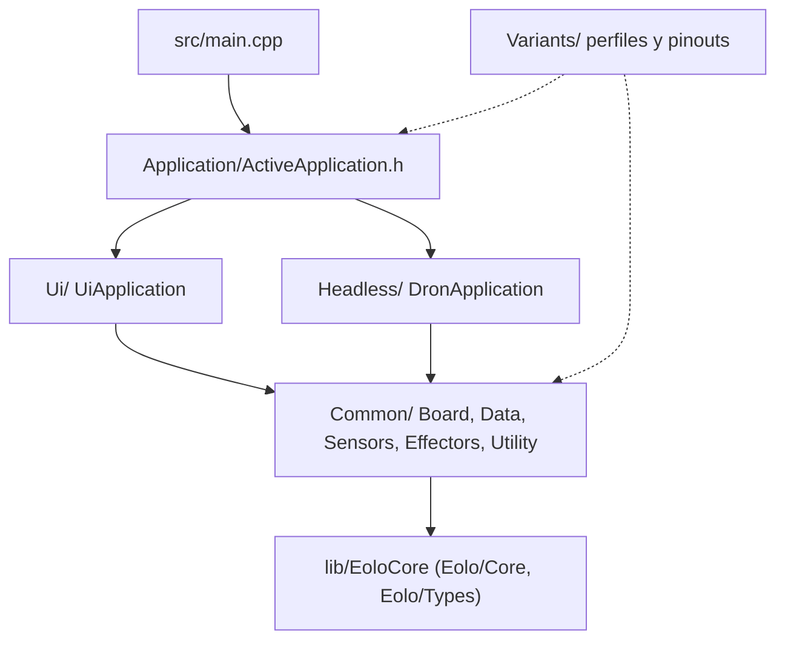

# Arquitectura del firmware

Este documento describe cómo se organiza el código de EOLO: capas, dependencias y puntos de entrada.
Sirve para saber dónde vive cada cosa antes de cambiarla.
La sección «Deuda técnica conocida» lista lo que aún no está separado.

El firmware es header-only (`.h`/`.hpp`), con `src/main.cpp` como única unidad de compilación propia. La lógica portable está en `lib/EoloCore` y se prueba en el host con `pio test -e native`.

## Capas



Si tu visor no renderiza Mermaid, el mismo esquema en texto:

```text
main.cpp
  -> Application/ActiveApplication.h   elige la aplicación según EOLO_TARGET_*
       -> Ui/        Express Rev.1/Rev.2, EOLO-MP, Mini Rev.2
       -> Headless/  Mini Rev.1
            -> Common/  Board, Data, Sensors, Effectors, Utility
                 -> lib/EoloCore  lógica portable, sin Arduino

Variants/  perfil y pinout por modelo; lo leen Application y Common
Modem/     pila del módem de EOLO-MP (la usa Ui y Common, no Headless)
```

`ActiveApplication.h` selecciona `UiApplication` para `eolo_express`, `eolo_express_legacy`, `eolo_standard` y `eolo_dron`, y `DronApplication` para `eolo_dron_legacy`. `main.cpp` solo instancia `ActiveApplication` y delega `begin()` y `update()`.

`Ui/` y `Headless/` no pueden incluirse entre sí, y `Headless/` tampoco incluye `Modem/`. `scripts/check_family_boundaries.py` lo verifica.

## EoloCore

`lib/EoloCore/include/Eolo/` contiene tipos, parsers, conversiones y máquinas de estado que no conocen Arduino, FreeRTOS, RTClib, SD, Wi-Fi, `Preferences`, `WebServer` ni `Context`. Los includes públicos son `<Eolo/Core/...>` y `<Eolo/Types/...>`. `scripts/audit_eolo_core_deps.sh` falla si aparece una de esas dependencias.

El entorno `native` compila esta capa sin placa. Incluye:

- Modelos de AFM07, FS3000, anemómetro y Plantower, y el contrato fresco/obsoleto de sensores.
- PID, control de ignición del motor, protección térmica NTC, PWM, batería y programación de flujo.
- Máquinas de estado de captura y de calibración de motor.
- `LogRecord`, `TelemetrySnapshot` y estados de sesión y setup headless.
- Utilidades del módem (`HttpUrl`, `AtResponse`, `SignalQuality`) y parseo de comandos de consola.

El parser RTC produce `RtcDateTime` y epoch; `RTCManager` construye el `RTClib::DateTime`. `Session::startUnix` es el único tipo de hora del core. NVS conserva la clave histórica `startDate`.

## Sensores y hardware

Los drivers que dependen de pines, buses o tareas del ESP32 viven en `src/Common/Sensors` y `src/Common/Board`. Cada sensor es un adaptador sobre su modelo del core: `begin()` es idempotente y `getData(DTO&)` informa validez y frescura. Las demos reutilizan esos modelos en vez de copiar parsers.

`ActiveFlowSensor.h` elige el sensor de flujo con `FEATURE_FLOW_AFM07` o `FEATURE_FLOW_FS3000`; definir ambos o ninguno es un error de compilación.

No existe una librería `EoloHardware`. Extraerla solo tiene sentido cuando los drivers dejen de depender de los perfiles globales y de `Context`.

## Variantes

`src/Variants/` reúne todo lo que cambia entre modelos. `ActiveProfile.h` selecciona un perfil por entorno y expone sus constantes y `FlowPidConfig`. `Pinout.h` selecciona un mapa de GPIO completo por modelo. `VariantValidation.h` y `PinoutValidation.h` rechazan combinaciones inválidas. Detalle en [compilacion.md](compilacion.md).

`src/Variants/Legacy.h` mantiene alias de macros para código antiguo. El código nuevo usa `ActiveProfile.h`.

## Persistencia, SPI y módem

`SettingsStore` es la interfaz portable de configuración y `PreferencesSettingsStore` la implementa sobre NVS, con los namespaces y claves históricos. `SessionStore` guarda la sesión (`eolo_session`, clave `startDate`).

En EOLO-MP, OLED y SD comparten VSPI; `SPIBus::Guard` serializa inicialización, render y operaciones de SD. Las URLs y cuerpos HTTP del módem pasan por `ModemHttpContract`, que rechaza solicitudes demasiado largas en lugar de truncarlas.

## Flujo de una captura

`Context` coordina el ciclo: sondea la protección térmica, aplica la seguridad de captura y llama a `CaptureController::update()`. El controlador calcula tiempo y flujo objetivo, actualiza motor y volumen y pide un registro cada 10 segundos. Un fallo de seguridad aborta la captura y deja el motor en PWM cero. `LogService` escribe el CSV en la SD y solo recibe `LogRecord`; `UploadService` solo publica `TelemetrySnapshot`.

## Deuda técnica conocida

`Common/` no debería depender de `Ui/`, `Headless/` ni `Modem/`, pero hoy lo hace en 14 includes. Están listados en `KNOWN_COMMON_DEPENDENCIES` de `scripts/check_family_boundaries.py`. El script falla si aparece una nueva o si una de la lista deja de existir, así que la lista solo puede bajar. Salen de seis archivos:

- `Common/Data/Components.h` incluye `Modem/` (tres headers) y `Ui/Input.h`.
- `Common/Data/Context.h` y `Common/Data/ContextCaptureController.h` incluyen `Ui/Drawing/SceneManager.h`; `Context.h` además `Ui/Drawing/Logos.h` y `Headless/ContextHeadlessMotorCalibration.h`.
- `Common/Utility/DebugConsole.h` incluye los comandos de depuración de `Headless/` y `Modem/`, y `Modem/ModemService.h`.
- `Common/Data/RTCNetworkSync.h` y `Common/Data/UploadService.h` incluyen `Modem/`.

La causa de fondo es que `Context.h` (864 líneas) y `Components.h` son una sola raíz de composición para todas las familias. `Context` crea los componentes, inicializa el hardware, ejecuta el ciclo y conecta captura, motor, UI, SD y módem. Separar `Context` y `Components` por familia eliminaría la mayoría de las excepciones.

`CaptureController` todavía coordina escenas, sesión, motor, logging y módem desde `Context`. Sus definiciones están en `Data/ContextCaptureController.h`, que `Context.h` incluye al final.

Quedan además tres tareas de separación que no cambian el comportamiento:

- Separar el formato CSV del backend SD para poder escribir otras salidas.
- Si hace falta, conectar el upload a una cola de snapshots.
- Mover captura, protección térmica y PID a entradas y salidas explícitas en `Context`.

## Verificación

```bash
python3 scripts/check_pinouts.py            # pinouts contra la documentación
python3 scripts/check_family_boundaries.py  # límites entre familias
bash scripts/audit_eolo_core_deps.sh        # EoloCore sin dependencias de hardware
```

`check_pinouts.py` puede informar una discrepancia pendiente de validar en hardware; ver [discrepancias-pines.md](../hardware/discrepancias-pines.md). Los entornos y los flags están en [compilacion.md](compilacion.md); las pruebas, en [test/README.md](../../test/README.md).
