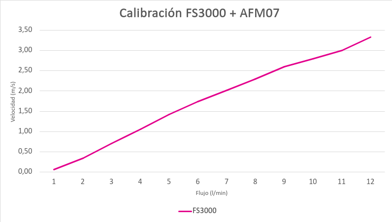

# Calibración de flujo y bombas

Describe cómo EOLO relaciona la lectura del sensor de flujo con el caudal real y con la potencia de las bombas.
Sirve para entender qué datos hay en esta carpeta y cuándo hay que recalibrar.

## Archivos

| Archivo | Contenido |
| --- | --- |
| `calibracion-fs3000.png` | Gráfico de la curva FS3000 contra AFM07 |
| `FS3000Cal.csv` | Los 12 pares `velocity,flow` de esa curva: velocidad del FS3000 en m/s y flujo del AFM07 en L/min |
| `FS3000Cal.py` | Script de ejemplo: carga el CSV con `pandas` e imprime las primeras filas. Importa `matplotlib` pero no grafica |
| `EOLO_Calibracion_v2.pdf` | Informe de calibración fechado el 2025-12-19, exportado desde `Calibración.md`, el documento que antecedió a este README. Parte de su contenido es anterior al código actual |

Los 12 puntos de `FS3000Cal.csv` son los mismos que usa el firmware en `lib/EoloCore/include/Eolo/Core/Sensors/FS3000FlowModel.h`. Si cambias uno, cambia el otro.

## Calibraciones y tablas de control

Hay que distinguir la curva de conversión del FS3000, la tabla estática del modelo y una curva de bombas medida para un equipo.

La curva del FS3000 convierte velocidad de aire a caudal. Solo aplica al FS3000; el AFM07 entrega L/min directamente y no requiere esa conversión.

Mini Rev.2 usa una tabla estática de 10 puntos (`kFlowFeedForward` en `src/Variants/Profiles/Dron.h`), integrada en el firmware. No es una calibración individual ni se genera desde la pantalla. MP usa control por caudal sin una curva personalizada de bombas.

Express Rev.2 y Express Rev.1 (Legacy) permiten medir una curva opcional de bombas desde «Control de flujo» > «Medir». Esa curva relaciona PWM y flujo para ese equipo y sirve como semilla de arranque; el controlador sigue ajustando el caudal en lazo cerrado. Sin curva guardada el control automático también funciona. El proceso no cambia la curva del sensor FS3000.

## Del FS3000 al caudal

El FS3000 se usa en EOLO Express Rev.1 (`eolo_express_legacy`). Sus lecturas se convierten a L/min con la curva de `FS3000Cal.csv`.

La curva se obtuvo el 2025-12-19, según la fecha del PDF y del primer commit de `FS3000Cal.csv`. Se hizo pasar aire a varios caudales conocidos, medidos por un AFM07 como referencia, y para cada caudal se anotó la velocidad que midió el FS3000 instalado dentro de la pieza. La curva depende de la geometría de esa pieza. El repositorio no guarda el nombre de la pieza, el operador ni los datos crudos.

`FS3000FlowModel::flowFromVelocity` interpola linealmente entre esos puntos. Devuelve `-1` si la velocidad no es válida o no es positiva y `0` bajo `0.06 m/s`. Sobre `3.33 m/s` extrapola con el último tramo.

## Curva de usuario para Express

La medición recorre la potencia de los motores y registra qué caudal produce cada nivel. El resultado es una tabla de puntos con el PWM de cada motor y el flujo medido. El controlador la usa como punto de partida para un objetivo de flujo, no como sustituto del control en lazo cerrado.

Los límites de la tabla están en `lib/EoloCore/include/Eolo/Core/Calibration/CalibrationModel.h`: mínimo 6 puntos, máximo 200, y un rango de flujo de al menos 0.25 L/min. El control de flujo en lazo cerrado se describe en [Control de flujo](../../firmware/control-de-flujo.md).

La tabla se guarda en la Flash del ESP32 con `Preferences` (namespace `eolo_calib`), sin usar la SD. `src/Common/Data/CalibrationManager.h` la escribe en dos registros alternados con checksum. Si un corte de energía interrumpe el guardado, se conserva la última curva válida. Una calibración guardada con una versión anterior del formato se descarta y hay que repetirla.

Medir esta curva es opcional. Los controles de flujo por modelo y el proceso de Express están descritos aquí:

- [EOLO Express Rev.1 y Rev.2](../../manuales/express.md#calibración) — «Medir» crea una curva opcional de arranque.
- [EOLO-MP](../../manuales/mp.md#calibración) — control por caudal, sin barrido manual de bombas.
- [EOLO Mini Rev.2](../../manuales/mini-rev2.md#calibrar-bombas) — tabla estática del modelo, sin curva de usuario.
- [EOLO Mini Rev.1](../../manuales/mini-rev1.md#calibración) — control cerrado headless, sin barrido de bombas desde la pantalla.

## Cuándo recalibrar

En Express, vuelve a medir la curva de bombas si cambias bombas, mangueras, filtros o el circuito de aire, o si el flujo real no sigue al objetivo. Después, valida el comportamiento con una prueba en el equipo antes de una campaña. Cambiar la pieza que aloja al FS3000 requiere repetir su curva de conversión y actualizar `FS3000FlowModel.h`. Los cambios a tablas estáticas o parámetros del control requieren validación en hardware.

En FS3000, los valores de `flow` del CSV dependen de la curva de conversión del sensor. La curva de bombas afecta al PWM aplicado, no a la conversión de la lectura a L/min. El [formato de los datos](../../datos/README.md) describe esa columna.
