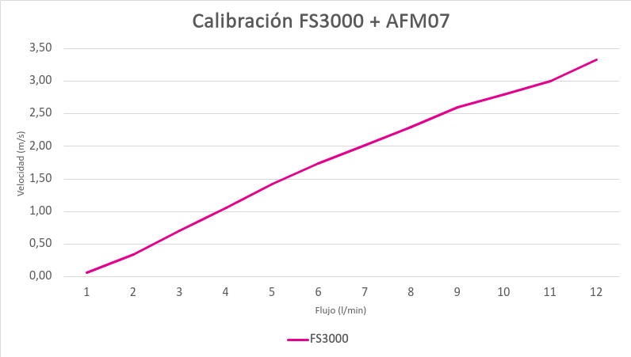

# Calibración de flujo y bombas

Describe cómo EOLO relaciona la lectura del sensor de flujo con el caudal real y con la potencia de las bombas.
Sirve para entender qué datos hay en esta carpeta y cuándo hay que recalibrar.

## Archivos

| Archivo | Contenido |
| --- | --- |
| `calibracion-fs3000.png` | Gráfico de la curva FS3000 contra AFM07 |
| `FS3000Cal.csv` | Los 12 pares `velocity,flow` de esa curva: velocidad del FS3000 en m/s y flujo del AFM07 en L/min |
| `FS3000Cal.py` | Script de ejemplo: carga el CSV con `pandas` e imprime las primeras filas. Importa `matplotlib` pero no grafica |
| `EOLO_Calibracion_v2.pdf` | Informe de calibración fechado el 2025-12-19, exportado desde `Calibración.md`, el documento que antecedió a este README. Parte de su contenido es anterior al código actual |

Los 12 puntos de `FS3000Cal.csv` son los mismos que usa el firmware en `lib/EoloCore/include/Eolo/Core/Sensors/FS3000FlowModel.h`. Si cambias uno, cambia el otro.

## Dos calibraciones distintas

EOLO tiene dos calibraciones que no hay que confundir.

La primera convierte la lectura de un sensor en caudal. Solo aplica al FS3000, que mide velocidad de aire. Las variantes con AFM07 la omiten, porque el AFM07 entrega L/min directamente.

La segunda relaciona el caudal con la potencia de las bombas. Aplica a todas las variantes que tienen el menú de calibración de bombas y sirve para que el control de flujo llegue al objetivo más rápido.

## Del FS3000 al caudal

El FS3000 se usa en EOLO Express Rev.1 (`eolo_express_legacy`). Sus lecturas se convierten a L/min con la curva de `FS3000Cal.csv`.

La curva se obtuvo el 2025-12-19, según la fecha del PDF y del primer commit de `FS3000Cal.csv`. Se hizo pasar aire a varios caudales conocidos, medidos por un AFM07 como referencia, y para cada caudal se anotó la velocidad que midió el FS3000 instalado dentro de la pieza. La curva depende de la geometría de esa pieza. El repositorio no guarda el nombre de la pieza, el operador ni los datos crudos.

`FS3000FlowModel::flowFromVelocity` interpola linealmente entre esos puntos. Devuelve `-1` si la velocidad no es válida o no es positiva y `0` bajo `0.06 m/s`. Sobre `3.33 m/s` extrapola con el último tramo.

## Bombas y flujo objetivo

La calibración de bombas recorre la potencia de los motores y registra qué caudal produce cada nivel. El resultado es una tabla de puntos con el PWM de cada motor y el flujo medido. El equipo la ordena por flujo y la usa para estimar el PWM que corresponde a un caudal objetivo.

Los límites de la tabla están en `lib/EoloCore/include/Eolo/Core/Calibration/CalibrationModel.h`: mínimo 6 puntos, máximo 200, y un rango de flujo de al menos 0.25 L/min. El control de flujo en lazo cerrado se describe en [Control de flujo](../../firmware/control-de-flujo.md).

La tabla se guarda en la Flash del ESP32 con `Preferences` (namespace `eolo_calib`), sin usar la SD. `src/Common/Data/CalibrationManager.h` la escribe en dos registros alternados con checksum. Si un corte de energía interrumpe el guardado, se conserva la última curva válida. Una calibración guardada con una versión anterior del formato se descarta y hay que repetirla.

Con la calibración se llega antes al objetivo, pero no es obligatoria: sin curva guardada el control ajusta el caudal en lazo cerrado desde el inicio. Los pasos para ejecutarla están en el manual de cada variante:

- [EOLO Express Rev.2](../../manuales/express.md#calibración)
- [EOLO-MP](../../manuales/mp.md#calibración)
- [EOLO Mini Rev.1](../../manuales/mini-rev1.md#calibración)

## Cuándo recalibrar

Recalibra al cambiar bombas, mangueras, filtros o cualquier parte del circuito de aire, y cuando el flujo real no siga al objetivo. Hazlo también antes de una campaña crítica. Si cambias la pieza que aloja al FS3000, hay que repetir la curva del sensor y actualizar `FS3000FlowModel.h`.

Por la misma razón, los valores de `flow` del CSV dependen de esta calibración. El [formato de los datos](../../datos/README.md) describe esa columna.
